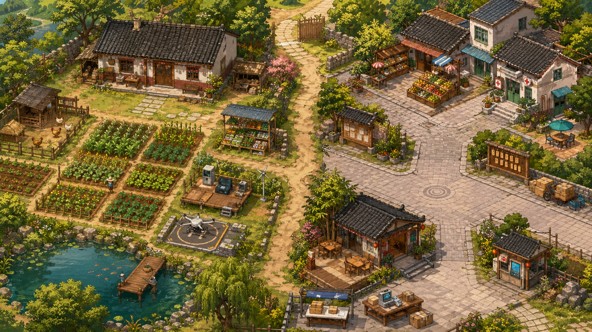
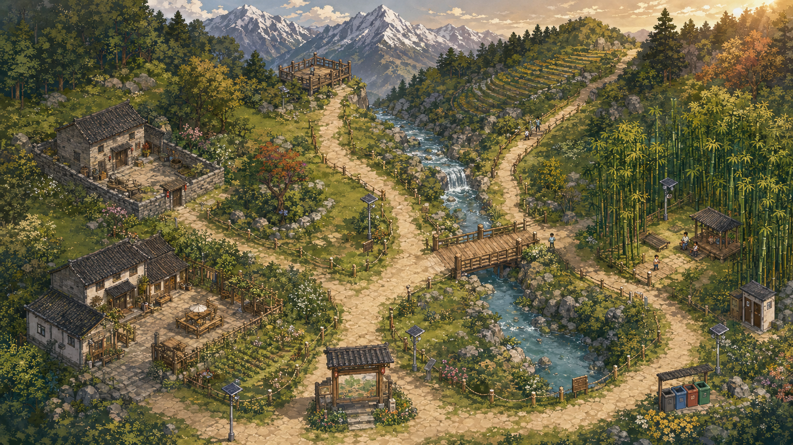
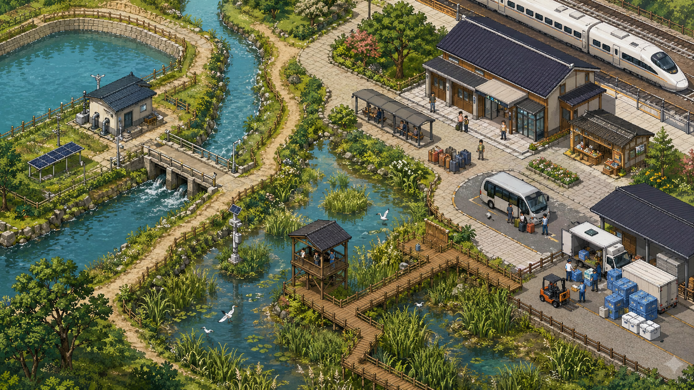
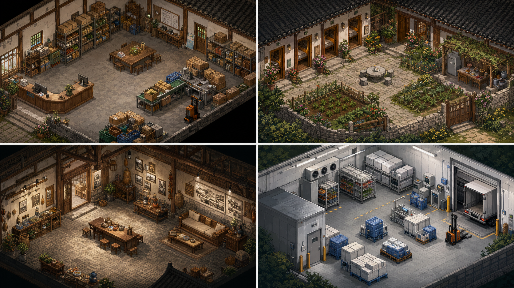

# 晨谷农场地图大纲

最后更新：2026-04-30

本文档根据 `DESIGN.md` 和当前原型地图实现整理，用于后续拆分地图配置、资源制作和关卡迭代。地图方向锁定为斜俯视 2D + Y-sort；第一轮继续使用 30x20 格统一场景，后续再按区域扩展尺寸。

## 地图设计目标

- 服务主线：每张地图都对应乡村振兴的一类问题，而不是只做装饰场景。
- 形成闭环：农业生产、村庄组织、电商物流、农文旅、基础设施和长期经营要能在空间上串起来。
- 可见变化：主线推进后，地图上必须出现建筑、路牌、摊位、灯光、设施或 NPC 行程变化。
- 控制复杂度：先做清晰的区域功能和动线，再补细节资产、天气季节变体和事件。

## 世界拓扑

```text
                                  雪山步道
                                     |
                                  暗夜公园
                                     |
                                  云栖观
                                     |
         山谷景区 —— 梯田林缘
                                  /  |  \
                         老石屋室内  |   民宿小院
                                     |
农场 —— 村子主街 —— 手作工坊 —— 高铁站接驳区 —— 候车亭/停车场
 |       /  |  \        |             |
牧场  合作社仓库 冷链仓室内  竹编/腌菜/陶艺工坊室内  冷链月台
         |
      河湾水利 —— 河湾湿地

电力线：河湾小水电/水坝式微水电 —— 村级配电房 —— 冷链仓/路灯/无人机/新能源车
        屋顶光伏/太阳能棚 —— 储能电池 —— 暗夜公园低光步道/民宿/工坊
        山口风车 —— 备用电力；应急火电站只作灾害和大型活动保底

农场内：老宅室内
```

村子主街是核心枢纽。玩家早期在农场和村子之间往返，中期向北打开后山景区，后期向东、向南打开工坊、交通和水利基础设施。

拓扑分为两层：

- 主地图：农场、村子主街、山谷景区、手作工坊、河湾水利、河湾湿地、高铁站接驳区、牧场、雪山步道、梯田林缘。这些是玩家移动和日常循环的主要空间。云栖观和暗夜公园先作为未来生态文化扩展节点，位于山谷景区和雪山步道之间。
- 小场景：老宅室内、合作社仓库、冷链仓室内、老石屋室内、民宿小院、候车亭/停车场、竹编/腌菜/陶艺工坊室内、冷链月台。这些不必一开始做成完整大地图，优先作为关键建筑的室内、院落或任务场景，用来承接订单、叙事、展示和短任务。

## 概念图索引

以下概念图用于统一地图美术方向和建筑分布，不作为最终瓦片地图。后续拆分正式资源时，以这些图的空间关系、建筑轮廓和氛围为参考，再按实际网格和 Y-sort 规则重绘。

| 概念图 | 覆盖场景 | 文件 |
| --- | --- | --- |
| 核心农场与村子 | 农场、村子主街、集市、电商角、茶铺、卫生站 | `assets/concept/chengu-core-farm-village-concept.png` |
| 后山农文旅 | 山谷景区、老石屋、竹林、民宿、雪山观景、梯田林缘 | `assets/concept/chengu-mountain-tourism-concept.png` |
| 基建与交通 | 河湾水利、河湾湿地、高铁站接驳区、冷链月台 | `assets/concept/chengu-infrastructure-transport-concept.png` |
| 小场景室内 | 合作社仓库、民宿小院、老石屋室内、冷链仓室内 | `assets/concept/chengu-small-scenes-concept.png` |









### 实装级场景 Mockup

以下图片更接近当前小型 Canvas 2D 游戏能实际做到的水平：格子更清楚、建筑更简化、细节密度更低，适合作为正式地图拆分和资产制作的直接参考。

| 场景 | 文件 |
| --- | --- |
| 农场 | `assets/concept/practical-scenes/farm.png` |
| 村子主街 | `assets/concept/practical-scenes/village-main-street.png` |
| 老宅室内 | `assets/concept/practical-scenes/home-interior.png` |
| 牧场 | `assets/concept/practical-scenes/pasture.png` |
| 山谷景区 | `assets/concept/practical-scenes/scenic-valley.png` |
| 手作工坊 | `assets/concept/practical-scenes/workshop-district.png` |
| 河湾水利 | `assets/concept/practical-scenes/waterworks.png` |
| 河湾湿地 | `assets/concept/practical-scenes/wetland-reserve.png` |
| 高铁站接驳区 | `assets/concept/practical-scenes/station-shuttle.png` |
| 雪山步道 | `assets/concept/practical-scenes/alpine-trail.png` |
| 梯田林缘 | `assets/concept/practical-scenes/terrace-forest-edge.png` |
| 合作社仓库 | `assets/concept/practical-scenes/cooperative-warehouse.png` |
| 民宿小院 | `assets/concept/practical-scenes/homestay-courtyard.png` |
| 老石屋室内 | `assets/concept/practical-scenes/old-stone-house-interior.png` |
| 冷链仓室内 | `assets/concept/practical-scenes/cold-chain-warehouse.png` |
| 竹编/腌菜/陶艺工坊室内 | `assets/concept/practical-scenes/bamboo-pickle-workshop.png` |

## 区域总览

| 地图 | 主线定位 | 核心玩法 | 关键视觉变化 |
| --- | --- | --- | --- |
| 农场 | 第一块地与日常生产 | 种植、浇水、收获、养花、钓鱼、鸡舍、科技农业 | 菜地恢复、温室、鸡舍、自动灌溉、传感器 |
| 老宅室内 | 生活感与休息 | 休息、鱼缸、宠物、导师/家人引导 | 宠物床、鱼缸、书架、节日装饰 |
| 村子主街 | 组织能力枢纽 | 公告栏、订单、分拣、快递、直播、合作社、基建、公约 | 集市门面、电商角、合作社门面、旅游街、接驳点 |
| 牧场 | 畜牧与生态循环 | 鸡舍扩展、饲料、粪肥、民宿早餐前置 | 草场、堆肥区、饲草棚、牲畜栏 |
| 手作工坊 | 加工与伴手礼 | 竹编、腌菜、风干菜、陶艺、礼盒、研学订单 | 竹编屋、腌菜坊、陶艺窑房、晒场、手作摊 |
| 高铁站接驳区 | 外部流量入口 | 游客接驳、冷链月台、伴手礼外销 | 站房、接驳车位、冷链月台、伴手礼亭 |
| 河湾水利 | 现代基础设施 | 水渠、蓄水池、泵房、太阳能泵 | 修复水渠、桥、闸门、微电网设施 |
| 村级能源线 | 电力生成、储能和负载调度 | 小水电、太阳能、风车、应急火电、配电、储能 | 配电房、光伏棚、风机、充电桩、低光路灯 |
| 河湾湿地 | 生态约束 | 观鸟、水质监测、生态研学、限流 | 木栈道、芦苇区、观测点、水质牌 |
| 山谷景区 | 农文旅主入口 | 资源调查、半日徒步线、游客中心、民宿选址 | 导览牌、游客服务、生态厕所、垃圾分类点 |
| 云栖观 | 山水文化与生态边界 | 节气茶、药草圃、静线游客、水源规约 | 山门、正殿、素茶廊、药草圃、禁入林线 |
| 暗夜公园 | 低干扰夜游与生态保护 | 观星、限光、静音、夜行动物记录、星空课堂 | 暗光步道、观星平台、红光指示、夜行动物缓冲区 |
| 雪山步道 | 景观与水源保护 | 高山水源、天气站、救援点、摄影终点 | 雪线、岩壁、观景台、保护线 |
| 梯田林缘 | 农耕景观与保育 | 梯田研学、老林缘观察、农事体验 | 梯田坡、林缘禁入线、观景坡 |

## 分区大纲

### 1. 农场

定位：玩家第一天就能理解的主循环地图。这里承担“种出第一批菜”的情绪和系统入口。

```text
┌──────────── 农场 ────────────┐
│ 农资摊/集市筐        老宅入口 │
│                              │
│      主农田/工具范围展示       │
│                              │
│ 鸡舍/粪肥/科技站      池塘/渔具 │
│   ↓ 牧场门              → 村子 │
└──────────────────────────────┘
```

规划与建筑分布：
- 东北生活区：老宅、门廊、晾衣绳、小菜篮和回家小径。老宅门口保留 2 格以上空地，方便做回家提示、节日装饰和 NPC 等待事件。
- 中央生产区：主农田放在中央偏西，使用规整矩形田块，周围留一圈窄路。田块要能清楚展示普通工具、3 格线、3x3 和 5x5 工具升级效果。
- 西北农资区：种子摊、临时集市筐、价签板和小遮棚。早期是买种子点，助农集市后叠加菜篮点和周转筐。
- 西南畜牧科技区：鸡舍、饲料桶、粪肥堆、科技站、无人机停机板。这里表现“传统畜牧 -> 生态循环 -> 数字农业”的升级链。
- 东南水产区：池塘、钓鱼码头、渔具板、生态鱼塘牌。池塘边留出民宿鱼鲜订单和宠物陪伴钓鱼的站位。
- 东侧出村口：通往村子，路面从泥路逐步升级为石板路或水泥路。
- 南侧牧场门：通往牧场，使用木栅栏门和草道，和农田区做视觉区分。

推进变化：
- 第 1 章：荒地变成可耕作菜地。
- 第 2 章：种子摊和集市周转筐更明显。
- 第 4 章：温室、鱼塘和鸡舍纳入合作社订单。
- 第 7 章：水渠、自动灌溉和传感器在农田边出现。

### 2. 老宅室内

定位：提供休息、陪伴和叙事缓冲，不承担复杂经济。

```text
┌────────── 老宅室内 ──────────┐
│ 炉灶/案板   鱼缸/照片墙   床 │
│                              │
│        桌子/规划图/对话位     │
│                              │
│ 宠物区/玩具箱          玄关门 ↓│
└──────────────────────────────┘
```

规划与建筑分布：
- 南侧玄关：门、鞋柜、雨具、农具挂钩，返回农场。节日时可挂灯笼、艾草或春联。
- 东北休息区：床、床头柜、日历和窗户，是推进时间和日终反馈的位置。
- 中央起居区：桌子、旧木椅、规划图和导师/家人站位，用于主线对话和年度复盘。
- 西北厨房区：炉灶、水缸、案板和节日食材，可承接简单料理、民宿早餐准备或节日食物。
- 北侧展示区：鱼缸、书架、照片墙，展示钓鱼收集、乡村记忆和玩家成长。
- 西南宠物区：宠物床、玩具箱、食盆和小垫子，宠物领养后成为高频互动角。

推进变化：
- 宠物领养后增加猫狗互动。
- 节日时出现装饰或特殊对话。
- 民宿支线成熟后，可在室内补家乡记忆、旧照片和规划图。

### 3. 村子主街

定位：全游戏的组织枢纽。玩家从个人种地转向村庄协作，主要在这里发生。

```text
┌──────────── 村子主街 ────────────┐
│ 基建角       游客中心       卫生站 │
│                                  │
│ 集市/杂货店 ─ 公共广场 ─ 茶铺体验 │
│    ↑农场        │公告/合作社   →工坊│
│ 快递/分拣/直播  │              伴手礼│
│              ↓ 河湾水利            │
└──────────────────────────────────┘
```

规划与建筑分布：
- 十字主路：横向连接农场、手作工坊和高铁方向，纵向连接后山景区和河湾水利。十字路口是玩家识别方向的核心地标。
- 中央公共广场：公告栏、订单板、合作社窗口、年终公约墙和村民集合点。广场早期留白，后续逐步被牌匾、长凳、摊棚和公共基金公告填满。
- 西侧商业集市带：杂货店、助农集市棚、菜篮点、试吃摊和统一价签。这里表现从零散卖菜到有组织集市的变化。
- 西南物流加工带：分拣台、包装台、快递驿站、直播角、工具工坊。建筑要贴近道路，形成“农货进来 -> 分拣包装 -> 发货出去”的短动线。
- 北中游客服务带：游客服务中心、导览牌、路线集合点、游客休息凳。后山开放后这里成为游客进入村子的第一站。
- 东北公共服务带：卫生站、急救箱、游客急救点和老人配菜提示。节日或游客高峰时这里应显得更忙。
- 东南茶歇体验带：茶铺、茶歇棚、手作体验桌、伴手礼小架。第 6 章后承接农文旅体验。
- 西北基建角：村级基建板、水电冷链进度牌和施工材料堆。第 7 章前可只是空地和旧水管，第 7 章后变成公共设施展示角。
- 东侧出村口：通往手作工坊和高铁方向，适合放接驳箭头、物流指示牌和外地订单提示。

推进变化：
- 第 2 章：村口出现集市摊、菜篮点和试吃摊。
- 第 3 章：快递点、直播架、包装台和溯源码海报成型。
- 第 4 章：订单板升级为合作社窗口。
- 第 5-6 章：游客服务中心、导览牌、茶歇与伴手礼变明显。
- 第 7 章：水利、电力、冷链和接驳标识进入主街。
- 第 8 章：广场挂出发展公约，成为长期经营入口。

### 4. 山谷景区

定位：农文旅 MVP 的核心地图。先调查，再规划，再开放路线，避免一上来就开发。

```text
┌──────────── 山谷景区 ────────────┐
│        ↑ 雪山步道 / 水源保护       │
│ 雪山观景台        竹林研学点       │
│                                  │
│ 老石屋文化点 ─ 河流/木桥 ─ 亲水码头│
│                                  │
│ 民宿选址        景区规划牌      →梯田│
│        ↓ 村子入口 / 游客集合        │
└──────────────────────────────────┘
```

规划与建筑分布：
- 南侧入口区：村子来路、游客导览牌、路线集合点和景区规划牌。开放前是临时木牌，开放后升级为正式导览入口。
- 中轴步道：贯穿南北的主山路，跨过河流处设置木桥。所有资源点从主路分叉，避免玩家迷路。
- 北部观景区：雪山观景台、安全栏、天气提示牌和拍照点。它是半日徒步线的视觉终点，但不能摆商业摊位。
- 中部亲水区：河流、亲水码头、防滑牌、救援圈和钓鱼点。这里承接河边垂钓、夏季亲水和水质科普。
- 西中村史区：老石屋外场、石凳、茶歇小桌和村史说明牌。进入老石屋室内后承接文化展示和手作讲解。
- 西南住宿预留区：民宿选址、小院门、菜园角和夜间安静提示牌。民宿成熟后从“选址”升级为可进入的小院。
- 东北竹林研学区：竹林入口、竹编材料点、研学集合牌和踩踏保护线。连接手作工坊的竹编体验。
- 东侧外延路：通往梯田林缘，路口放梯田/老林缘方向牌。
- 北侧外延路：通往雪山步道，路口放天气风险和水源保护提示。

推进变化：
- 调查 3 个资源点后，规划牌开放半日徒步线。
- 游客服务开启后，入口从临时木牌升级为正式导览。
- 配套设施逐项出现：导览牌、休息点、生态厕所、垃圾分类点、太阳能路灯。
- 生态压力升高时，路线提示、限流牌和垃圾问题要能视觉化。

### 5. 手作工坊

定位：把农业原料和地方文化变成加工、伴手礼与研学内容。

```text
┌──────────── 手作工坊 ────────────┐
│ 竹编工坊/竹材堆      腌菜坊/陶缸 │
│                                  │
│ ← 村子入口 ── 中央工坊路 ── 高铁 →│
│                                  │
│ 晒场/风干架      陶艺窑房/手作摊 │
└──────────────────────────────────┘
```

规划与建筑分布：
- 中央工坊路：横向连接村子和高铁站，纵向短路串起各加工点。道路应比村子主街窄，体现生产片区。
- 西北竹编区：竹编工坊、竹材堆、劈竹台、研学桌和半成品架。竹林资源点解锁后这里开始活跃。
- 东北腌菜区：腌菜坊、陶缸、清洗台、盐袋和晾棚。秋冬节气可强化年货和风味加工。
- 西南晒场区：风干菜架、晒席、陶土晾泥架、雨棚和天气提示牌。晴天与雨天能有不同表现。
- 东南陶艺与手作市集区：陶艺窑房、小柴窑或电窑、拉坯/手捏台、伴手礼摊、礼盒展示、游客体验桌和结算小柜。高铁接驳后这里与站点形成外销动线。
- 陶土来源：河湾水利、湿地边缘和梯田沟渠附近只可设置少量合规取土点，避免把生态保护区变成无限采集点。
- 东侧物流出口：通往高铁站接驳区，放外销方向牌、装车点和打包箱。
- 小场景入口：竹编/腌菜/陶艺工坊室内可从对应建筑进入，用于短制作任务和研学演示。

推进变化：
- 第 5 章调查竹林后，竹编研学可用。
- 第 6 章民宿和游客稳定后，礼盒、晒场、陶艺体验和体验摊显著增加。
- 第 7 章高铁接驳后，伴手礼外销提示进入站点方向。

### 6. 河湾水利与湿地

定位：把“基础设施”和“生态边界”做成两个连续空间。

```text
┌──────────── 河湾水利 ────────────┐
│        ↑ 村子入口 / 工程牌         │
│ 泵房/旧水管          蓄水池/水位尺 │
│                                  │
│      河道 ─ 闸门/桥 ─ 河道       →湿地│
│                                  │
│ 施工材料              太阳能泵/配电 │
└──────────────────────────────────┘

┌──────────── 河湾湿地 ────────────┐
│ 水质监测点              观鸟棚   │
│                                  │
│ ←水利入口 ─ 木栈道/小桥 ─ 观察线 │
│                                  │
│ 芦苇保育区/禁入绳       浅水湿地 │
└──────────────────────────────────┘
```

河湾水利规划与建筑分布：
- 北侧入口：返回村子，入口处放水利工程牌、施工材料和村民讨论点。
- 中央河道：河流横穿地图，桥和闸门在中部形成视觉焦点。闸门旁适合做水渠修复任务。
- 西北泵房区：旧泵房、水管、工具箱和维修牌。早期破旧，修复后接入农场灌溉收益。
- 东北蓄水区：蓄水池、水位尺、安全围栏和巡检小道。旱季可显示水位变化。
- 东南能源区：太阳能泵、配电箱、小型光伏板和检修通道。与第 7 章电力基础设施联动。
- 东侧水路出口：通往河湾湿地，路口放“保育区/低干扰观察”提示，提醒玩家从工程区进入生态区。

河湾湿地规划与建筑分布：
- 西侧入口：返回水利区，设置湿地说明牌和限流牌。
- 中央木栈道：以木栈道和小桥作为唯一主路，玩家不应随意穿越芦苇区。
- 东北观鸟区：观鸟棚、望远镜、静音提示和鸟类记录板。适合亲子自然观察。
- 西南芦苇保育区：芦苇、浅水、禁入绳和保育标识，作为生态压力的主要可视化区域。
- 北中水质监测区：取样点、水质牌、简易实验桌和研学站位。连接水利系统和生态评分。

推进变化：
- 水渠修复后，农场灌溉收益要能在农田体现。
- 蓄水池和太阳能泵建成后，河湾出现工程设施但保留自然边界。
- 湿地不应变成普通游乐区，重点是低干扰观鸟、水质课堂和限流。

### 7. 村级能源线

定位：第七章现代基础设施的电力骨架。它不是单个建筑，而是一条从“发电端”到“用电端”的村级能源网络。

```text
┌──────────── 村级能源线 ────────────┐
│ 山口风车/高地风机      屋顶光伏/光伏棚│
│                                      │
│ 河湾小水电/水坝式微水电 —— 村级配电房 │
│                                      │
│ 储能电池 —— 路灯/冷链/无人机/新能源车 │
│                                      │
│ 应急火电/备用发电机：灾害和大型活动保底│
└──────────────────────────────────────┘
```

发电设施分布：
- 河湾小水电 / 水坝式微水电：放在河湾水利区闸门、蓄水池和泵房附近。提供稳定底电，但需要生态评估，不能破坏湿地水流。
- 太阳能：村口屋顶、游客中心、泵站光伏棚、民宿屋顶、景区太阳能路灯。白天发电，依赖储能支撑夜间用电。
- 风车 / 小型风机：放在山口、梯田林缘或雪山步道前段的高地边缘。用于补充阴天和夜间电力，但要避开鸟类迁飞和核心景观。
- 火电站 / 应急发电站：建议设为村外边缘或物流集散场附近的小型备用设施，只在灾害天气、冷链保底或大型活动时启用，带来污染、噪声和村民意见压力。
- 储能电池：放在村级配电房、冷链仓和游客中心附近，决定夜间路灯、暗夜公园低光步道和冷链保底能力。

用电设施分布：
- 村子主街：路灯、公告栏照明、合作社包装设备、直播设备。
- 农场：无人机充电、土壤传感器、自动灌溉控制器。
- 河湾水利：泵站、闸门控制、自动灌溉。
- 手作工坊：陶艺电窑、烘干、包装设备和夜间照明。
- 冷链仓 / 高铁站：预冷设备、冷链月台、新能源接驳车充电桩。
- 山谷景区：游客中心、太阳能路灯、应急点。
- 云栖观 / 暗夜公园：低光步道、红光指示、观星平台设备，必须控制光污染。
- 民宿小院 / 社区食堂：热水、照明、保鲜和早餐供应。

推进变化：
- 第七章前段：村级配电房和太阳能路灯先出现，解决主街和游客中心夜间安全。
- 第七章中段：小水电、光伏棚和储能电池上线，冷链仓和自动灌溉稳定运行。
- 第七章后段：风车、新能源车充电桩、无人机充电站和陶艺电窑接入。
- 第八章：形成电力调度规则，公共服务、冷链和应急照明优先，夜游和节日灯光根据余量开放。

好 / 坏状态：
- 好状态：配电房指示灯稳定、储能柜整齐、路灯按区亮起、冷链仓正常运转、新能源车准点、无人机可巡田。
- 坏状态：路灯间歇熄灭、冷链仓使用临时冰袋、无人机停飞、接驳车减班、陶艺窑房烧制失败、村民抱怨火电噪声。

### 8. 高铁站接驳区

定位：后期外部连接点，解释游客、冷链和县城订单如何进入村子。

```text
┌────────── 高铁站接驳区 ──────────┐
│ 伴手礼亭             站房/时刻牌 │
│                                  │
│ ← 工坊入口   接驳车位/候车棚   →县城│
│                                  │
│ 游客集合点           冷链月台/预冷 │
└──────────────────────────────────┘
```

规划与建筑分布：
- 西侧入口：返回手作工坊，入口放村庄旅游路线牌和物流方向牌。
- 北部站房区：站房、售票/咨询窗、县城时刻牌和游客集合点。站房不需要完整大城市规模，重点是“外部世界入口”。
- 西中接驳区：接驳车位、候车棚、停车线、行李架。高铁接驳建成后这里成为游客进入村子的可视化来源。
- 东南冷链物流区：冷链月台、预冷箱、蓝色标识、装卸板车和发货清单。冷链仓室内可从这里进入。
- 西北伴手礼区：伴手礼亭、礼盒展示、节气海报和扫码牌。手作工坊产物在这里外销。
- 东侧预留边界：不继续展开县城，只用道路、栏杆和远景站台表达外部连接。

推进变化：
- 高铁接驳点建成前，这里偏“县城边缘预留区”。
- 接驳完成后，游客和订单反馈在村子主街、游客中心和工坊同步变化。
- 冷链仓完成后，生鲜包裹损耗下降，站内月台要有预冷箱、蓝色冷链标识。

### 9. 雪山步道

定位：后山景观高潮，同时承担水源保护和安全边界。

```text
┌──────────── 雪山步道 ────────────┐
│          雪垭口/观景终点          │
│                                  │
│ 高山水源保护区    步道    天气站 │
│                                  │
│        救援小屋 / 登记牌          │
│              ↓ 山谷景区           │
└──────────────────────────────────┘
```

规划与建筑分布：
- 南侧入口：返回山谷景区，放海拔提示、天气风险牌和路线难度牌。
- 中轴雪山步道：窄步道、积雪边、岩石和护栏。步道要清楚表达只能沿线通行。
- 北中雪垭口：观景终点、风向旗、拍照点和安全围栏。这里是景观奖励，不做商业服务。
- 东北天气站：小型气象站、风速仪、太阳能板和预警牌。与雷雨、雪天和游客安全任务联动。
- 西南水源保护区：高山水源、保护线、禁入牌和科普牌。只能观察和记录，不做采集。
- 东南救援点：救援小屋、急救箱、担架和路线登记牌。游客线路开放后承担安全配套。

推进变化：
- 开放初期只做观景和调查，不做摊位。
- 水源地发现后，必须出现保护线或禁入提示。
- 天气站可与节气、雷雨、雪天和游客安全提示联动。

### 10. 梯田林缘

定位：连接农耕景观、研学体验和森林保育。

```text
┌──────────── 梯田林缘 ────────────┐
│ 梯田生产区/水渠        老林缘保育 │
│                                  │
│ ←山谷入口 ─ 等高线步道 ─ 观察点  │
│                                  │
│ 体验小田/观景台        缓冲草坡  │
└──────────────────────────────────┘
```

规划与建筑分布：
- 西侧入口：返回山谷景区，入口放梯田研学和老林保育双方向牌。
- 中轴步道：沿等高线弯折，连接观景坡、体验田和林缘观察点。步道要避开生产田埂核心区。
- 西中梯田生产区：梯田、水渠、田埂和农具棚。这里主要展示真实农业生产，不作为游客自由踩踏区。
- 南中体验观景区：观景平台、插秧体验小田、摄影点和洗手水槽。游客体验被限制在小范围内。
- 东北老林缘区：林缘观察牌、禁入线、志愿者记录板和林下植物点。只做观察、巡护和自然教育。
- 东南缓冲区：草坡、休息凳和小茶点位，作为生产区与保育区之间的过渡。

推进变化：
- 梯田体验区和生产区必须分开，避免游客破坏田埂。
- 老林缘只做观察、志愿活动和生态说明，不做商业摊位。
- 第 6 章以后可承接节气农事、插秧体验和摄影路线。

### 11. 云栖观

定位：山路中段的生态文化节点。它不是玄幻系统，也不是大型商业景区，而是节气文化、草本养生、山林规约和水源保护的空间表达。

```text
┌──────────── 云栖观 ────────────┐
│ 老松/禁入林线        上山小径 ↑ │
│                                  │
│ 药草圃        正殿/香案        钟亭│
│                                  │
│ 素茶廊       观景台/风铃廊      山泉│
│                                  │
│        ↓ 返回山谷景区入口        │
└──────────────────────────────────┘
```

规划与建筑分布：
- 南侧入口：石阶、旧山门、返回山谷景区，前期只露出旧路和藤蔓。
- 中央正殿：小而朴素，用于节气对话、山林规约和村民祭山/谢水事件。
- 西侧药草圃：艾草、薄荷、紫苏、藿香等草本作物，联动茶铺、卫生站和手作香囊。
- 东侧钟亭/风铃廊：提供节气、天气和山路安全提示。
- 西南素茶廊：低干扰游客休息点，和茶铺的节气茶、素茶套餐联动。
- 东南山泉/古井：连接水源保护主题，不做采集刷资源点。
- 北侧上山小径：通往暗夜公园、雪山步道或高山水源地，后期按生态规则限流。

推进变化：
- 第五章：后山调查时只作为传闻和旧石阶出现。
- 第六章：半日徒步线稳定后清理山门，开放节气静线和素茶廊。
- 第六章后段：药草圃、香草晒架和竹风铃联动手作工坊。
- 第七章：成为水源保护和山林禁入边界的文化节点。
- 第八章：山林规约写入发展公约，成为长期生态文化维护点。

### 12. 暗夜公园

定位：生态保护线的高级建设项目。它不是游乐园，而是通过低光污染、夜游限流、静音规则和夜行动物缓冲区，把夜间旅游变成低干扰体验。

```text
┌──────────── 暗夜公园 ────────────┐
│ 暗光步道/低位路灯        观星平台 │
│                                  │
│ 夜行动物缓冲区      红光指示牌    │
│                                  │
│ 静音露营点          星空课堂棚    │
│                                  │
│        ↓ 云栖观 / 山谷景区入口     │
└──────────────────────────────────┘
```

规划与建筑分布：
- 南侧入口：从云栖观或山谷景区进入，设置夜间规则牌和限流入口。
- 中央暗光步道：低位暖光或红光指示，避免普通路灯照亮山林。
- 东北观星平台：望远镜、躺椅、星图板和少量游客站位。
- 西中夜行动物缓冲区：禁入线、红外观察点和记录牌，只观察不捕捉。
- 东中红光指示牌：提示低光污染、静音和不离开步道。
- 西南静音露营点：少量帐篷位，不做大规模营地。
- 东南星空课堂棚：联动村小学/研学中心，做天文和光污染科普。
- 北侧限制通道：连接雪山步道或高山水源地，夜间可能关闭。

推进变化：
- 第六章后期：游客提出看星空，夜游带来强光、噪声和踩踏问题。
- 第七章前段：建设低光步道和静音规则，降低夜游风险。
- 第七章中段：开放观星平台、夜行动物缓冲区和星空课堂棚。
- 第八章：暗夜保护条款写入发展公约，成为高口碑、低生态压力的特色路线。

### 13. 小场景规划

小场景用于承接关键建筑的内部功能，不需要一开始都做成 30x20 大地图。建议使用 12x8、16x10 或局部院落尺寸，重点是交互密度和叙事表达。

#### 老宅室内

入口：农场东北老宅。

```text
┌──── 老宅室内 ────┐
│ 厨房  展示墙  床 │
│                  │
│    桌子/对话位   │
│ 宠物区      玄关↓│
└──────────────────┘
```

建筑分布：
- 南侧玄关：返回农场、雨具、农具挂钩。
- 东北休息区：床、日历、窗，承担休息和日终推进。
- 中央起居区：桌子、规划图、家人/导师对话站位。
- 西北厨房区：炉灶、水缸、案板，承接节日食物和民宿早餐前置。
- 北侧展示区：鱼缸、书架、照片墙，展示收集和家乡记忆。
- 西南宠物区：宠物床、食盆、玩具箱。

#### 合作社仓库

入口：村子主街中央合作社窗口或订单板。

```text
┌──── 合作社仓库 ────┐
│      会议角/白板    │
│ 仓储货架 分级区 包装│
│                    │
│      入口柜台 ↓     │
└────────────────────┘
```

建筑分布：
- 南侧入口柜台：订单接取、交付、结算和村民对话。
- 西侧共享仓储：周转筐、货架、称重台，表现村民共同供货。
- 中央分级区：分拣桌、品控牌、溯源码打印机。
- 东侧品牌包装区：礼盒样品、统一包装、品牌海报。
- 北侧会议角：白板、长桌、收益分配和合作社会议事件。

用途：
- 第 4 章成立合作社时进入。
- 后续用于批量订单、统一包装、村民协商和品牌升级。

#### 冷链仓室内

入口：村子主街冷链仓或高铁站冷链月台。

```text
┌──── 冷链仓室内 ────┐
│ 设备间/应急电源    │
│ 预冷区  分拣线  发货│
│                    │
│      收货口 ↓       │
└────────────────────┘
```

建筑分布：
- 南侧收货口：农货箱、扫码台、入库记录。
- 西侧预冷区：冷风机、预冷架、温度计。
- 中央分拣动线：保温箱、冰袋台、损耗检测点。
- 东侧发货口：装车门、月台提示、快递单。
- 北侧设备间：配电箱、应急电源、维修工具。

用途：
- 降低物流损耗的可视化场景。
- 可做短任务：检查温度、补冰袋、处理破损箱。

#### 老石屋室内

入口：山谷景区老石屋文化点。

```text
┌──── 老石屋室内 ────┐
│     旧梁柱保护区    │
│ 村史展示 茶歇 手作展│
│                    │
│        门厅 ↓       │
└────────────────────┘
```

建筑分布：
- 南侧门厅：村史牌、游客进入点、讲解员站位。
- 西侧村史展示：旧农具、照片、修路/水渠/集市记忆。
- 中央茶歇区：小桌、长凳、山茶和节气点心。
- 东侧手作展示：竹编、腌菜坛、风干菜样品。
- 北侧保护区：旧梁柱、安全支撑和“不可改造”提示。

用途：
- 连接村史、手作、茶歇和文化研学。
- 强调“修旧如旧”，不把文化点改成普通商店。

#### 民宿小院

入口：山谷景区老宅民宿选址。

```text
┌──── 民宿小院 ────┐
│ 菜园角       客房 │
│                  │
│ 石桌/花坛/合影点 │
│ 早餐区       院门↓│
└──────────────────┘
```

建筑分布：
- 南侧院门：入住牌、游客留言、安静提示。
- 西侧客房门廊：房间入口、行李架、晾晒区。
- 中央院落：石桌、花坛、宠物合影点。
- 东侧早餐区：小厨房、鱼鲜早餐桌、茶水台。
- 北侧菜园角：小菜畦、香草、鸡蛋篮或本地食材展示。

用途：
- 承接过夜线、民宿早餐、宠物合影、节日预约。
- 小院要安静克制，和村民生活边界保持清楚。

#### 候车亭/停车场

入口：高铁站接驳区东侧或村子主街接驳站牌。

```text
┌── 候车亭/停车场 ──┐
│ 服务角/雨伞/急救  │
│ 候车棚  接驳车位 反馈│
│                  │
│      村子/站点入口│
└──────────────────┘
```

建筑分布：
- 西侧候车棚：座椅、路线牌、班次表。
- 中央停车位：接驳车、行李装卸区、游客集合点。
- 东侧返程反馈点：游客评价牌、遗失物箱、投诉/建议箱。
- 北侧服务角：饮水、急救包、雨伞架。

用途：
- 表达高铁接驳不是纯数值，而是游客流线的一部分。
- 节假日可显示排队、满车或加班车。

#### 竹编/腌菜/陶艺工坊室内

入口：手作工坊对应建筑。

```text
┌── 竹编/腌菜/陶艺工坊室内 ──┐
│ 竹材架/编织桌  陶缸/案板    │
│                      │
│ 陶土桶/拉坯台  试吃台/晾架   │
│      伴手礼打包/窑房出口 ↓   │
└──────────────────────────┘
```

建筑分布：
- 竹编室内：竹材架、劈竹台、编织桌、研学座位、成品展示。
- 腌菜室内：清洗台、切菜案板、陶缸、发酵日期牌、试吃台。
- 陶艺室内：陶土桶、淘洗盆、揉泥台、拉坯台、手捏桌、釉料小架、素坯晾架。
- 窑房：小型柴窑或电窑、温度牌、柴火/电力提示、冷却架。烧制需要等待时间，不做即时产出。
- 共用出口：伴手礼打包桌和游客体验登记牌。

用途：
- 承接手作制造、研学体验、陶艺体验和伴手礼礼盒。
- 季节变化明显：夏季偏竹编避暑，秋冬偏腌菜年货，雨后和水利任务后更容易触发陶土采集与陶艺订单。

#### 冷链月台

入口：高铁站接驳区东南。

```text
┌──── 冷链月台 ────┐
│ 异常处理/退货记录 │
│ 暂存区  装卸区  车辆│
│                  │
│      仓库入口 ←   │
└──────────────────┘
```

建筑分布：
- 西侧暂存区：保温箱、冷链标签、扫码牌。
- 中央装卸区：板车、月台边线、发车倒计时牌。
- 东侧车辆位：冷链车或接驳货车。
- 北侧异常处理角：破损箱、退货记录、客服提示。

用途：
- 表达外地订单发运的最后一段。
- 物流损耗高时，异常处理角要比平时更醒目。

## 区域升级线路

区域升级不是单纯换皮，而是跟随主线问题逐层改变：先出现生活痕迹，再出现组织能力，最后出现长期维护规则。每条线路都应同时带来至少一种空间变化和一种 NPC/订单/回访变化。

### 主地图升级线

#### 农场

```text
荒着的老宅地
  -> 第一块规整菜地
  -> 集市供货农场
  -> 合作社标准生产田
  -> 生态循环农场
  -> 智能灌溉示范田
  -> 年度成果展示农场
```

| 阶段 | 触发 | 空间变化 | 玩法变化 |
| --- | --- | --- | --- |
| 初始 | 开局 | 荒草、旧宅、少量可耕地 | 翻地、播种、浇水 |
| 第一章 | 第一次收获和出售 | 菜地成形，货箱和种子摊被使用 | 基础种植闭环 |
| 第二章 | 助农集市 | 周转筐、菜篮点、集市供货提示 | 集市订单指定作物 |
| 第四章 | 合作社成立 | 温室、鱼塘、鸡舍挂上合作社用途 | 批量供货、鱼鲜和花卉纳入品牌 |
| 第六章 | 民宿和旅游订单 | 早餐食材、花艺摆放、宠物合影点更明显 | 农产品进入游客体验 |
| 第七章 | 水利和传感器 | 水渠、喷灌、无人机平台、土壤传感器 | 自动润湿、病虫害预警 |
| 第八章 | 年终大会 | 成果牌、合影点、年度示范田 | 年度评价和下一年方向 |

#### 老宅室内

```text
返乡临时住处
  -> 可休息的家
  -> 生活收集空间
  -> 宠物和记忆空间
  -> 民宿/节日准备空间
  -> 年度复盘空间
```

| 阶段 | 触发 | 空间变化 | 玩法变化 |
| --- | --- | --- | --- |
| 初始 | 开局 | 简单床、桌子、炉灶 | 休息和基础引导 |
| 第二章 | 宠物、钓鱼、花卉入口 | 宠物床、鱼缸、照片墙开始有内容 | 抚摸、喂食、鱼缸展示 |
| 第六章 | 民宿和节日活动 | 厨房食材、早餐准备、节日装饰 | 民宿早餐和节日预备 |
| 第八章 | 年终大会 | 规划图、旧照片、年度合影 | 村庄相册和成果回看 |

#### 村子主街

```text
安静旧主街
  -> 公告和零散需求
  -> 助农集市街
  -> 电商发货街
  -> 合作社公共广场
  -> 旅游导览街
  -> 基建接驳街
  -> 公约广场
```

| 阶段 | 触发 | 空间变化 | 玩法变化 |
| --- | --- | --- | --- |
| 初始 | 开局 | 杂货店、公告栏、卫生站、茶铺 | 走访和小订单 |
| 第二章 | 助农集市 | 集市棚、价签、菜篮点、试吃摊 | 社区订单、节气小单 |
| 第三章 | 电商助农 | 分拣台、包装台、快递箱、直播架 | 分级、包装、发货、直播反馈 |
| 第四章 | 合作社成立 | 合作社牌匾、共享仓储角、统一品牌标识 | 批量订单、村民协商 |
| 第五-六章 | 后山路线和游客 | 游客服务中心、导览牌、茶歇点、伴手礼架 | 游客接待、研学集合 |
| 第七章 | 基建完成 | 冷链标识、太阳能灯、接驳站牌、水电工程牌 | 冷链、交通、公共设施维护 |
| 第八章 | 发展公约 | 公约墙、年度合影、公共基金公告 | 长期经营和下一年方向 |

#### 山谷景区

```text
传闻中的后山旧路
  -> 资源调查路线
  -> 半日徒步线
  -> 游客服务景区
  -> 农文旅体验区
  -> 生态限流景区
  -> 长期保护示范区
```

| 阶段 | 触发 | 空间变化 | 玩法变化 |
| --- | --- | --- | --- |
| 未开放 | 前置传闻 | 北边旧路、临时木牌、村民提醒 | 对话悬念 |
| 第五章 | 进入调查 | 老石屋、竹林、河码头、民宿选址、观景点可记录 | 资源点图鉴和手绘地图 |
| 第五章后段 | 记录 3 个资源点 | 正式路线牌、半日徒步线 | 游客路线开放 |
| 第六章 | 游客服务 | 休息点、垃圾分类、生态厕所、太阳能路灯 | 游客收益和生态压力 |
| 第六-七章 | 生态压力变化 | 踩踏草坡、垃圾、限流牌或修复标识 | 限流、配套维护 |
| 第八章 | 年度复盘 | 保护说明、游客留言、生态成果牌 | 评级和长期保护 |

#### 手作工坊

```text
闲置手艺点
  -> 竹编/腌菜试作
  -> 挖泥巴与陶艺试烧
  -> 手作订单点
  -> 研学体验工坊
  -> 伴手礼外销区
  -> 村级加工扩展预留
```

| 阶段 | 触发 | 空间变化 | 玩法变化 |
| --- | --- | --- | --- |
| 未开放 | 茶铺和老手艺人传闻 | 村东旧工坊方向牌 | 对话悬念 |
| 第五章 | 竹林调查 | 竹材堆、劈竹台、腌菜缸、晒场 | 第一件手作样品 |
| 第六章前段 | 河湾/梯田发现陶土点 | 陶土桶、淘洗盆、揉泥台、素坯晾架 | 挖泥巴、淘洗、揉泥、制坯 |
| 第六章 | 游客体验 | 研学桌、试吃台、陶艺体验桌、伴手礼摊 | 手作订单、陶艺研学、路线联动 |
| 第七章 | 电力和接驳完善 | 小窑房、温度牌、外销方向牌、礼盒陈列 | 烧瓷器、伴手礼外销和站点联动 |
| 长期 | 加工链深化 | 合作社大院/加工中心预留入口 | 更复杂加工树预留 |

#### 河湾水利

```text
老旧水渠
  -> 水渠修复点
  -> 蓄水和泵房系统
  -> 自动灌溉支撑区
  -> 清洁能源水利区
  -> 长期维护工程区
```

| 阶段 | 触发 | 空间变化 | 玩法变化 |
| --- | --- | --- | --- |
| 未开放 | 旱天、农田缺水传闻 | 村南旧水渠提示 | 前置问题 |
| 第七章前段 | 水渠修复 | 清淤水渠、闸门、维修工具 | 水利建设任务 |
| 第七章中段 | 蓄水池和自动灌溉 | 蓄水池、水位尺、喷灌管线 | 自动润湿农田 |
| 第七章后段 | 太阳能微电网 | 光伏板、太阳能泵、配电箱 | 电力支撑冷链和路灯 |
| 第八章 | 发展公约 | 巡检牌、维护记录、节水说明 | 长期维护和公共投入 |

#### 村级能源线

```text
旧配电箱
  -> 太阳能路灯
  -> 村级配电房
  -> 小水电 / 光伏 / 储能
  -> 风车补能
  -> 负载调度：冷链 / 无人机 / 新能源车 / 路灯
  -> 应急火电保底
```

| 阶段 | 触发 | 空间变化 | 玩法变化 |
| --- | --- | --- | --- |
| 初始 | 第七章前传闻 | 旧配电箱、零散路灯 | 夜间能力弱 |
| 第七章前段 | 建太阳能路灯 | 村口和游客中心亮灯 | 夜间安全和游客评价提高 |
| 第七章中段 | 建配电房和储能电池 | 配电房、储能柜、光伏棚 | 电力容量和夜间供电可追踪 |
| 第七章中段 | 建河湾小水电 | 水坝式微水电、闸门旁发电机 | 冷链和泵站获得稳定底电 |
| 第七章后段 | 建风车 / 小型风机 | 山口或梯田高地出现风机 | 阴天和夜间补能 |
| 第七章后段 | 接入用电负载 | 无人机充电站、新能源车桩、陶艺电窑 | 巡田、接驳、烧窑和冷链稳定 |
| 第八章 | 建立调度规则 | 负载优先级牌、公共用电公约 | 公共服务优先，夜游按余量开放 |
| 应急 | 灾害或大型活动 | 临时火电/备用发电机 | 保底供电，但带来污染和噪声压力 |

#### 河湾湿地

```text
下游野湿地
  -> 水质观察点
  -> 木栈道观鸟区
  -> 研学生态点
  -> 限流保育区
  -> 长期生态指标区
```

| 阶段 | 触发 | 空间变化 | 玩法变化 |
| --- | --- | --- | --- |
| 未开放 | 水利任务提到下游鸟群 | 远处芦苇、禁入提示 | 生态悬念 |
| 第七章 | 水利连通 | 水质监测点、木栈道入口 | 水质记录 |
| 第七-八章 | 生态配套 | 观鸟棚、静音牌、限流绳 | 观鸟、研学、生态评分 |
| 压力过高 | 游客过多 | 芦苇踩踏、投诉牌、临时封闭线 | 限流和修复任务 |
| 长期 | 公约落实 | 生态成果牌、志愿者记录 | 长期生态维护 |

#### 高铁站接驳区

```text
县城边缘预留地
  -> 接驳车位
  -> 游客入口
  -> 冷链月台
  -> 伴手礼外销口
  -> 周末客流门户
```

| 阶段 | 触发 | 空间变化 | 玩法变化 |
| --- | --- | --- | --- |
| 未开放 | 外地订单和游客留言 | 远处站牌、空车位 | 交通悬念 |
| 第七章 | 高铁接驳点 | 候车棚、接驳车位、路线牌 | 游客接送 |
| 第七章 | 冷链仓 | 冷链月台、蓝色箱、预冷区 | 降低物流损耗 |
| 第七-八章 | 手作外销 | 伴手礼亭、发货箱、游客评价牌 | 礼盒外销和返程反馈 |
| 长期 | 客流稳定 | 周末排队、加班车、评价板 | 周期性客流 |

#### 云栖观

```text
荒废小观
  -> 清理山门
  -> 节气静修点
  -> 药草与素茶节点
  -> 水源保护文化边界
  -> 低干扰山路示范点
```

| 阶段 | 触发 | 空间变化 | 玩法变化 |
| --- | --- | --- | --- |
| 未开放 | 后山传闻 | 山路边露出旧石阶和破山门 | 文化悬念 |
| 第五章 | 调查老山路 | 清理藤蔓，进入前院 | 记录文化资源点 |
| 第六章 | 半日徒步线开放 | 素茶廊、风铃、休息点修复 | 游客静线、节气茶点 |
| 第六章后段 | 手作/茶铺联动 | 药草圃、香草晒架、竹风铃 | 香草茶、节气香囊、研学 |
| 第七章 | 水源保护 | 禁入林线、山泉说明、保护牌 | 水源边界、生态评分 |
| 第八章 | 发展公约 | 山林规约牌、谢水活动点 | 长期文化与生态维护 |

#### 暗夜公园

```text
普通山路夜景
  -> 夜间问题暴露
  -> 低光步道
  -> 观星平台
  -> 夜行动物缓冲区
  -> 暗夜公园认证
  -> 星空节 / 生态研学
```

| 阶段 | 触发 | 空间变化 | 玩法变化 |
| --- | --- | --- | --- |
| 未开放 | 游客想看星空 | 山路夜景传闻 | 夜游需求 |
| 问题阶段 | 夜游游客增加 | 垃圾、噪声、强光手电投诉 | 夜间生态压力 |
| 建设 1 | 低光步道 | 低位灯、红光指示、静音牌 | 降低夜游风险 |
| 建设 2 | 观星平台 | 木平台、望远镜、星图架 | 星空游客收益 |
| 建设 3 | 夜行动物缓冲区 | 禁入线、红外观察点 | 生态评分提升 |
| 建设 4 | 星空课堂棚 | 小棚、坐垫、天文/生态课程 | 研学订单 |
| 长期 | 暗夜公园认证 | 认证牌、限流预约、夜间路线卡 | 高口碑低压力旅游 |

#### 雪山步道

```text
北边旧山路
  -> 观景调查点
  -> 安全步道
  -> 水源保护线
  -> 天气预警点
  -> 低干扰摄影终点
```

| 阶段 | 触发 | 空间变化 | 玩法变化 |
| --- | --- | --- | --- |
| 未开放 | 山谷景区传闻 | 北侧旧路、天气警示 | 探索悬念 |
| 第五章 | 观景调查 | 雪山观景台、安全栏 | 资源记录 |
| 第六章 | 徒步线开放 | 路线牌、休息点、救援登记 | 游客路线 |
| 第七章 | 天气站和水源保护 | 气象设备、保护线、禁入牌 | 安全预警和生态约束 |
| 长期 | 摄影和保育 | 低干扰拍照点、保护成果牌 | 节气景观回访 |

#### 梯田林缘

```text
山边生产坡
  -> 梯田观景点
  -> 体验田分区
  -> 老林缘保护线
  -> 农事研学路线
  -> 生产与保育共存区
```

| 阶段 | 触发 | 空间变化 | 玩法变化 |
| --- | --- | --- | --- |
| 未开放 | 游客提到梯田日落 | 东侧山路、梯田远景 | 旅游悬念 |
| 第五-六章 | 路线延展 | 观景坡、等高线步道 | 资源记录和拍照点 |
| 第六章 | 研学体验 | 体验小田、洗手槽、摄影点 | 插秧/收割体验 |
| 第六-七章 | 生态边界 | 老林缘禁入线、观察牌 | 林缘巡护 |
| 长期 | 年度公约 | 生产区和游客区标识固定 | 生产与旅游平衡 |

#### 牧场

```text
农场南侧草地
  -> 鸡舍扩展
  -> 饲草和堆肥点
  -> 民宿早餐供给
  -> 生态循环农业入口
```

| 阶段 | 触发 | 空间变化 | 玩法变化 |
| --- | --- | --- | --- |
| 第二章后 | 助农集市完成 | 鸡舍、饲料桶、围栏 | 喂鸡、鸡蛋 |
| 第六章 | 民宿早餐订单 | 蛋篮、早餐供货提示 | 鸡蛋进入游客订单 |
| 第七章 | 生态循环深化 | 粪肥堆、堆肥牌、草料棚 | 粪肥还田 |
| 未来 | 生态循环农业区 | 沼气/鱼菜共生/温室入口 | 循环农业扩展 |

### 小场景升级线

| 小场景 | 升级线路 | 关键变化 |
| --- | --- | --- |
| 合作社仓库 | 空置仓库 -> 共享仓储 -> 品控分级 -> 品牌包装 -> 村民会议室 | 货架变满、称重台启用、包装样品增加、会议白板记录收益分配 |
| 冷链仓室内 | 普通暂存 -> 预冷试点 -> 温控仓 -> 异常处理区 -> 稳定冷链节点 | 温度计、冷风机、冰袋台、破损箱和发货清单逐步出现 |
| 老石屋室内 | 旧屋保护 -> 村史展示 -> 茶歇点 -> 手作展示 -> 研学课堂 | 旧梁柱加固、照片墙、茶桌、手作展架、讲解路线 |
| 民宿小院 | 空院选址 -> 可入住小院 -> 早餐院落 -> 宠物合影点 -> 节日预约院 | 院门、客房门廊、早餐桌、花坛、留言本和节日装饰 |
| 候车亭/停车场 | 空车位 -> 候车棚 -> 接驳车位 -> 返程反馈点 -> 节假日加班车 | 座椅、班次牌、行李架、评价箱、排队线 |
| 竹编/腌菜/陶艺工坊室内 | 旧工坊 -> 试作台 -> 陶土处理 -> 制坯晾坯 -> 烧窑 -> 试吃和伴手礼打包 -> 季节年货点 | 竹材架、陶缸、编织桌、陶土桶、拉坯台、素坯架、小窑房、礼盒打包桌 |
| 冷链月台 | 普通发货口 -> 保温暂存 -> 装卸月台 -> 异常处理角 -> 外地订单稳定口 | 蓝色周转箱、扫码牌、板车、冷链车、退货记录 |
| 社区食堂室内 | 未来预留 -> 老人餐 -> 节日饭 -> 游客简餐 -> 公共服务节点 | 餐桌、配菜窗口、节日大锅、老人座位和志愿者排班 |
| 村委会议室 | 未来预留 -> 合作社会议 -> 生态限流讨论 -> 年终公约 -> 下一年规划 | 长桌、白板、公约草案、投票箱、规划图 |

## 动线节奏

早期 10 分钟：
- 老宅室内 -> 农场 -> 村子主街 -> 农场。
- 目标是让玩家学会种植、出售、读公告和接第一笔小订单。

第 2-4 章：
- 农场 -> 村子主街 高频往返。
- 村子主街逐渐承接集市、订单、分拣、包装、快递、直播和合作社。

第 5-6 章：
- 村子主街 -> 山谷景区 -> 雪山/梯田。
- 农场、工坊、景区开始形成“农产品/手作/民宿/游客”的循环。

第 7-8 章：
- 村子主街 -> 河湾水利/湿地 -> 手作工坊/高铁站。
- 空间重点从单点玩法转为全村运营：水、电、冷链、交通、生态和公约。

## 场景解锁沉浸规则

场景解锁不是单纯打开地图边界，而是要先让玩家感到“那里有一个问题正在等我”。每个新区域都按以下顺序进入主线：

1. 传闻阶段：通过 NPC 对话、公告栏、游客留言、订单文本或远景路牌提到该区域。
2. 缺口阶段：当前区域出现无法解决的问题，例如包装损耗、游客留宿、生态踩踏、水利不足。
3. 探路阶段：玩家获得一次短目标，去查看入口、旧路、建筑外观或临时设施。
4. 开放阶段：区域正式可进入，但只开放最核心的 1-2 个交互点。
5. 回访阶段：节气、订单、NPC 行程、设施升级或坏状态让玩家持续回到这里。

场景开放时必须同步至少两类反馈：

- 空间反馈：新路牌、修好的路、灯、摊位、箱子、栏杆、导览牌、仓储角或施工材料。
- 人物反馈：至少一个 NPC 改变站位、行程、对话或态度。
- 记忆反馈：重要节点进入村庄相册 / 变化手册。
- 压力反馈：如果玩家经营失衡，地图要显示垃圾、破损包裹、干裂土地、排队游客、堆箱或投诉牌。

各区域的沉浸钩子：

| 区域 | 解锁前悬念 | 开放后第一件小事 | 回访理由 |
| --- | --- | --- | --- |
| 农场 | 老宅地荒着，村民不确定玩家会不会留下 | 整理第一块菜地并卖出第一批菜 | 作物成长、天气、宠物、灌溉、花卉遗传 |
| 村子主街 | 公告栏有零散需求，村口空地没人组织 | 完成茶铺或卫生站第一笔订单 | 订单、集市、NPC 行程、建筑变化 |
| 手作工坊 | 老手艺人提到竹编没人学，游客想买伴手礼，河湾雨后露出好陶土 | 做第一件竹编、腌菜样品或陶艺素坯 | 研学、礼盒、节气加工、烧窑等待、外销订单 |
| 山谷景区 | 村民提到老石屋、竹林和雪山旧路 | 调查 3 个资源点并画进手绘地图 | 节气景观、游客反馈、生态压力、路线设施 |
| 河湾水利 | 农田旱天吃紧，下游水质也被提起 | 修第一段水渠或检查旧闸门 | 自动灌溉、水位变化、设备维护 |
| 河湾湿地 | 水利任务提到下游鸟群和水质 | 设置低干扰观察点或水质监测点 | 观鸟记录、研学、限流、生态评分 |
| 高铁站接驳区 | 外地订单和游客留言提到交通不便 | 标出接驳车位并完成一次游客接送 | 周末客流、冷链发货、返程评价 |
| 雪山步道 | 北边旧路、天气和水源传闻逐步出现 | 到达观景点并记录风险 | 天气变化、水源保护、安全巡查 |
| 梯田林缘 | 游客想看梯田日落，村民提醒别踩坏田埂 | 划分体验区和生产区 | 插秧体验、摄影路线、林缘观察 |

## 区域日常与状态表现

这些设计用于让旧地图每天都有回访价值，并让经营结果反映到场景中。优先级高于新增大地图。

### 每日小循环

| 区域 | 每日回访理由 | 轻量交互 |
| --- | --- | --- |
| 农场 | 巡田、看土壤水分、病虫害、作物成长 | 浇水、施肥、查看传感器、宠物陪伴 |
| 村子主街 | 看公告、听闲聊、接今日订单 | 读公告栏、交订单、与 NPC 对话 |
| 合作社仓库 | 看供货积压、分级、包装库存 | 分拣、补包装、批量交付 |
| 手作工坊 | 看天气决定晒场是否可用，查看陶坯是否晾干、窑是否冷却 | 晾晒、腌制、揉泥、制坯、烧窑、制作伴手礼 |
| 山谷景区 | 查看游客留言、路线垃圾、生态压力 | 清理、维护导览、接待小团 |
| 云栖观 | 查看节气提示、药草长势、山林规约 | 采收草本、泡节气茶、维护禁入线 |
| 暗夜公园 | 查看天气、光污染、夜行动物记录 | 调整低光灯、限流预约、观星记录 |
| 村级能源线 | 查看发电量、储能余量、用电负载和故障点 | 分配电力、检修配电房、调整路灯和充电桩 |
| 河湾水利 | 查看水位、渠况和泵站状态 | 清淤、检修、调整灌溉 |
| 河湾湿地 | 记录鸟类、水质和游客干扰 | 观鸟记录、水质取样、限流 |
| 高铁站接驳区 | 查看班次、冷链发车、返程评价 | 安排接驳、装车、处理反馈 |
| 民宿小院 | 准备早餐、整理客房、看留言本 | 摆早餐、换花、宠物合影 |

### 好 / 坏状态可视化

| 系统状态 | 好状态表现 | 坏状态表现 |
| --- | --- | --- |
| 助农集市 | 摊位整齐、价签统一、村民帮忙摆筐 | 摊位混乱、价签歪、无人看摊 |
| 电商物流 | 包裹码放整齐、快递车准点、好评单上墙 | 破损箱、退货单、快递员催促 |
| 合作社 | 货架饱满、白板有排产计划、村民送货 | 门口堆箱、订单积压、村民争论 |
| 后山旅游 | 路线清楚、垃圾桶干净、游客留言积极 | 草坡踩秃、垃圾满、投诉牌出现 |
| 云栖观静线 | 素茶廊安静、药草圃整洁、山林规约清楚 | 游客喧哗、香草被踩、禁入林线被越过 |
| 暗夜公园 | 星空清楚、低位灯柔和、夜行动物记录增加 | 强光手电、天空泛白、噪声投诉、记录减少 |
| 电力系统 | 路灯稳定、储能充足、冷链和无人机正常运行 | 路灯间歇熄灭、冷链临时冰袋、无人机停飞、接驳车减班 |
| 水利系统 | 水渠清澈、水位稳定、喷灌正常 | 水渠淤积、田地干裂、喷灌失效 |
| 冷链系统 | 预冷箱整齐、蓝色冷链标识清楚 | 临时冰袋、箱体凝水、异常记录 |
| 陶艺烧制 | 素坯晾架整齐、窑温稳定、成品釉色稳定 | 陶土太湿、坯体开裂、窑温失控、次品堆积 |
| 民宿服务 | 院子整洁、早餐摆好、留言本正面 | 院子凌乱、游客等待、差评留言 |
| 湿地生态 | 鸟类记录增加、芦苇区完整 | 踩踏痕迹、临时封闭线、鸟点减少 |

### 村民贡献可视化

合作社成立后，地图上的劳动者要逐渐变多，表现“村庄协作”：

- 种植户在合作社仓库送菜，或在农场边讨论排产。
- 茶铺老板在景区茶歇点摆桌，节气时更换茶点。
- 卫生站人员在游客路线设置急救点，节日时在广场义诊。
- 手艺人在老石屋或工坊讲解竹编、腌菜和陶艺；水利区村民提醒哪里能取陶土、哪里不能破坏湿地。
- 老人在社区食堂择菜、晒场翻晒、节日饭时帮忙。
- 孩子在研学中心、湿地或梯田做节气手账。
- 快递员在村口、冷链仓和高铁月台装箱。

### 远景承诺

未开放区域在主地图边缘先露出一点，不直接可达：

- 村子北边露出山路、云雾和旧木牌。
- 农场南边露出牧场围栏和草道。
- 山谷景区远处露出雪山和梯田。
- 山谷景区北侧旧山路露出云栖观的石阶和旧山门。
- 云栖观北侧夜间能看到暗夜公园方向的低位灯和观星平台轮廓。
- 水利区东侧露出芦苇湿地。
- 河湾水利和梯田沟渠边雨后露出陶土层，但保护区边界明确，不允许随意挖。
- 村口屋顶先露出少量光伏板，山口远处能看到风车预留基座，河湾闸门旁能看到微水电施工点。
- 手作工坊东边露出高铁轨道或接驳路。
- 梯田林缘远处露出老林深处但设禁入线。

### 节气短暂变样

| 节气 / 节日 | 地图变化 |
| --- | --- |
| 清明 | 老石屋、村口和山路出现踏青、扫墓和纸花氛围 |
| 立夏 | 茶铺出新茶，竹林更亮，河边开始有人纳凉 |
| 芒种 | 农田忙碌，NPC 更多出现在田边和仓库 |
| 小暑 | 河边、竹林游客变多，湿地限流更重要 |
| 白露 | 晒场最忙，风干菜和手作订单增加 |
| 谷雨 / 雨后 | 河湾、梯田沟渠边出现陶土采集提示，适合做第一批陶坯 |
| 霜降 | 腌菜坊、冷链仓和年货准备更重要 |
| 小雪 | 雪山步道出现特殊景观和天气风险 |
| 冬至 | 云栖观出现谢水、山林规约和节气茶活动 |
| 七夕 / 秋季晴夜 | 暗夜公园出现观星预约和星空课堂 |
| 春节 | 村口、公约墙、老宅和民宿小院出现灯笼与合影点 |

### 路线卡

旅游内容以路线卡组织，而不是单个景点堆叠：

| 路线 | 节点 | 需求 | 风险 |
| --- | --- | --- | --- |
| 半日徒步线 | 游客中心 -> 老石屋 -> 河边 -> 雪山观景台 | 导览牌、休息点、安全提示 | 体力、天气、垃圾 |
| 亲子研学线 | 竹林 -> 手作工坊 -> 湿地观鸟 | 研学桌、手作材料、观鸟棚 | 踩踏、噪声 |
| 过夜体验线 | 村口 -> 梯田夕照 -> 民宿早餐 | 民宿小院、早餐、夜间路灯 | 噪声、服务不足 |
| 节气农事线 | 农场 -> 梯田 -> 茶铺 -> 伴手礼 | 作物、体验田、茶歇、礼盒 | 天气、订单积压 |
| 陶艺研学线 | 河湾取土点 -> 手作工坊 -> 陶艺窑房 -> 伴手礼摊 | 合规取土点、揉泥台、窑房、包装 | 生态破坏、窑温失败、等待时间 |
| 电力巡检线 | 村级配电房 -> 河湾小水电 -> 光伏棚 -> 风车高地 -> 冷链仓 | 配电房、发电设施、储能电池 | 故障、生态影响、供电不足 |
| 山林静线 | 游客中心 -> 云栖观 -> 素茶廊 -> 水源保护牌 | 清理山门、素茶廊、山林规约 | 喧哗、越界、商业化过度 |
| 星空静线 | 游客中心 -> 民宿小院 -> 云栖观 -> 暗夜公园 -> 观星平台 | 民宿、低光步道、观星平台、晴夜天气 | 光污染、噪声、天气 |

### 道路升级

| 道路状态 | 使用场景 | 表现 |
| --- | --- | --- |
| 泥路 | 初期农场、后山旧路 | 雨天泥泞，移动或游客评价受影响 |
| 石板路 | 村子主街、老宅门口 | 集市后更整洁，适合村民聚集 |
| 木栈道 | 湿地、河边、山谷保护区 | 限制踩踏，降低生态压力 |
| 水泥路 | 物流线、高铁接驳线 | 支撑快递、冷链和接驳车 |
| 生态步道 | 后山、梯田、老林缘 | 低干扰路线，配合限流 |
| 夜间路灯 | 村口、景区入口、民宿线 | 支撑夜间返程和节日活动 |
| 暗光步道 | 云栖观、暗夜公园、雪山步道前段 | 用低位暖光或红光引导，降低夜间生态干扰 |
| 充电桩道路 | 高铁接驳区、冷链仓、村口物流线 | 支撑新能源车和冷链配送 |

### 看板叙事

| 区域 | 看板内容 |
| --- | --- |
| 农场 | 今日天气、土壤水分、病虫害风险 |
| 村口 | 今日订单、村民公告、节气活动 |
| 合作社 | 本周供货进度、包装库存、排产计划 |
| 景区 | 游客留言、路线开放、生态压力 |
| 云栖观 | 节气提示、山林规约、药草圃状态 |
| 暗夜公园 | 晴夜概率、光污染、夜行动物记录、限流预约 |
| 村级能源线 | 今日发电量、储能余量、用电负载、限电提示 |
| 水利 | 水位、泵站状态、维护任务 |
| 湿地 | 鸟类记录、水质、限流状态 |
| 高铁站 | 接驳班次、冷链发车、返程评价 |
| 民宿 | 入住留言、早餐菜单、安静公约 |
| 陶艺窑房 | 陶土湿度、晾坯进度、窑温、烧制完成时间 |

### 截图瞬间

- 第一次集市开张，村民站在棚子旁。
- 第一次快递车来村口取件。
- 合作社牌匾挂上去。
- 雨后旧山路露出来。
- 民宿小院第一盏灯亮起。
- 云栖观山门清理后，风铃第一次挂起。
- 暗夜公园第一次晴夜观星，游客安静坐在低光平台上。
- 第一窑瓷器开窑，村民和游客围在冷却架旁看成品。
- 高铁接驳车第一次到村口。
- 年终公约墙前村民合影。
- 春节夜晚村口灯笼亮起。

## 未来扩展计划

以下区域先作为后续版本储备，不进入当前第一轮地图配置。只有当第一年主线闭环稳定，并且对应系统需要更大的空间承载时，再评估是否展开。

### 候选主区域

| 区域 | 定位 | 主要用途 | 建议入口 | 加入条件 |
| --- | --- | --- | --- | --- |
| 村民住宅巷 | 生活感和 NPC 家庭关系 | NPC 住宅、邻里事件、节日串门、家庭支线 | 村子主街背后或东南侧 | 需要强化 NPC 路线和村民生活时 |
| 养老服务站 / 社区食堂 | 公共服务和老人照护 | 老人配菜、健康检查、社区食堂、节日陪伴 | 卫生站与茶铺附近 | 主线需要回应老人照护和公共服务时 |
| 生态循环农业区 | 农场、牧场、水利和科技农业的连接区 | 堆肥、沼气、鱼菜共生、温室育苗、病虫害观察 | 农场与牧场之间 | 畜牧和科技农业需要深化时 |
| 山货林下经济区 | 后山的非旅游型收益路径 | 菌菇、蜂箱、林下药草、山货采集、生态巡护 | 山谷景区与梯田林缘之间 | 需要平衡旅游开发和生态经济时 |
| 村小学 / 研学中心 | 教育、研学和公共文化 | 节气课堂、农业科普、儿童活动、村史课 | 村子北侧或景区入口旁 | 研学路线从活动文本升级为空间玩法时 |
| 云栖观 | 山水文化和生态边界 | 节气茶、草本香囊、素茶廊、山林规约、水源保护 | 山谷景区与雪山步道之间 | 后山旅游需要文化深度和生态规矩时 |
| 暗夜公园 | 低干扰夜游和暗夜生态保护 | 低光步道、观星平台、夜行动物缓冲区、星空课堂 | 云栖观与雪山步道之间 | 民宿过夜线成熟且需要控制夜游光污染时 |
| 合作社大院 / 村级加工中心 | 扩大后的产业中枢 | 共享仓储、初加工、品牌展厅、村民会议 | 村子主街中央或东南扩展区 | 合作社订单和加工链变复杂时 |
| 村口物流集散场 | 电商和高铁之间的中转空间 | 装车、分拨、退货、冷链临停、直播发货高峰 | 村子东侧，连接工坊和高铁方向 | 物流玩法需要从建筑点扩展为区域时 |
| 村级能源站 | 太阳能微电网实体化 | 光伏棚、储能柜、充电桩、路灯维护、冷链供电 | 河湾水利或村子南侧 | 第七章基建需要更强空间表现时 |

优先级建议：

1. 村民住宅巷：补足生活感，让村子不只是功能建筑集合。
2. 养老服务站 / 社区食堂：把乡村振兴从产业扩展到公共服务。
3. 生态循环农业区：把牧场、农场、水利和科技农业统一成循环系统。
4. 山货林下经济区：给后山增加非旅游收益路径，缓解“只能开发景点”的倾向。
5. 村小学 / 研学中心：承接竹林、湿地、梯田和老石屋的研学内容。
6. 云栖观：补足山村精神文化节点，把节气、山路、水源和生态边界连起来。
7. 暗夜公园：作为第六章后期到第七章之间的生态保护高级建设。

### 候选小场景

| 小场景 | 连接区域 | 用途 |
| --- | --- | --- |
| 社区食堂室内 | 养老服务站 / 茶铺 / 卫生站 | 老人餐、节日饭、游客简餐、民宿早餐供应 |
| 村史展厅 | 老石屋或村委 | 村史、旧照片、合作社发展、年终成果展示 |
| 直播间室内 | 村子主街电商角 | 正式直播、复购反馈、售后解释、品牌复盘 |
| 村委会议室 | 村子主街或合作社大院 | 合作社、公约、收益分配、生态限流决策 |
| 卫生站内室 | 卫生站 | 游客急救、老人照护、节日义诊 |
| 游客驿站室内 | 游客服务中心 | 路线登记、雨天候场、研学集合 |
| 云栖观素茶廊 | 云栖观 | 节气茶、草本茶点、静线游客休息 |
| 星空课堂棚 | 暗夜公园 / 村小学 | 光污染科普、星空课堂、夜行动物记录 |
| 陶艺窑房 | 手作工坊 / 河湾水利 | 淘泥、揉泥、制坯、晾坯、烧窑、陶瓷伴手礼 |
| 村级配电房 | 村子主街 / 河湾水利 | 分配电力、显示负载、设置公共服务优先级 |
| 储能电池房 | 村级能源线 | 存储太阳能和风电，支撑夜间路灯、冷链和暗夜公园低光设施 |
| 新能源车充电棚 | 高铁站接驳区 / 物流集散场 | 接驳车、冷链配送车和游客交通补能 |
| 应急发电间 | 村级能源线边缘 | 火电/柴油备用发电，灾害和大型活动保底，带来污染和噪声压力 |
| 工具工坊室内 | 村子主街工具工坊 | 工具升级、维修、材料消耗 |
| 种苗温室室内 | 农场温室或生态循环农业区 | 育苗、花卉遗传、反季节农业 |

暂不建议扩展：
- 大县城：会把重心从村庄系统拉向城市地图。
- 大型商业街：容易稀释乡村生产、公共服务和生态主题。
- 大型游乐区：与农文旅的低干扰、在地体验方向冲突。

## 地图配置落地建议

第一轮配置字段：

```js
{
  id: "village",
  name: "村子主街",
  size: { width: 30, height: 20 },
  terrain: "generated-or-tile-array",
  exits: [
    { to: "farm", edge: "west", range: [8, 12], spawn: { x: 28, y: 10 } }
  ],
  structures: [
    { id: "notice", kind: "notice", x: 14, y: 6, w: 2, h: 2, unlock: "always" }
  ],
  phases: [
    { id: "ecommerceCorner", unlock: "courierStation", decorations: [] }
  ]
}
```

优先拆分顺序：

1. 先把 `farm`、`village`、`home` 从硬编码拆到配置，保证第一块地闭环稳定。
2. 再拆 `scenic`、`alpine`、`terrace`，支撑后山资源点和手绘地图。
3. 最后拆 `workshop`、`waterworks`、`wetland`、`station`，承接中后期产业和基建。

## 美术资源优先级

第一优先级：
- 农场老宅、菜地、种子摊、货箱、村口杂货店、公告栏、订单板、卫生站、茶铺。

第二优先级：
- 分拣台、快递驿站、直播角、合作社门面、游客服务中心、景区导览牌。

第三优先级：
- 竹编工坊、腌菜坊、晒场、民宿选址、雪山观景台、河流码头、老石屋。

第四优先级：
- 水渠、蓄水池、太阳能泵、冷链仓、高铁接驳点、湿地木栈道、天气站。

## 验收标准

- 玩家不看指南也能从地图空间理解“农场生产 -> 村子组织 -> 出村销售 -> 后山旅游 -> 基建支撑”的关系。
- 每个新系统至少绑定一个地图地点、一个交互点和一个视觉变化。
- 主街、景区、农场三张核心地图在不同章节有明确前后对比。
- 生态保护区和生产区有可读边界，避免所有区域都变成同质化收益点。
